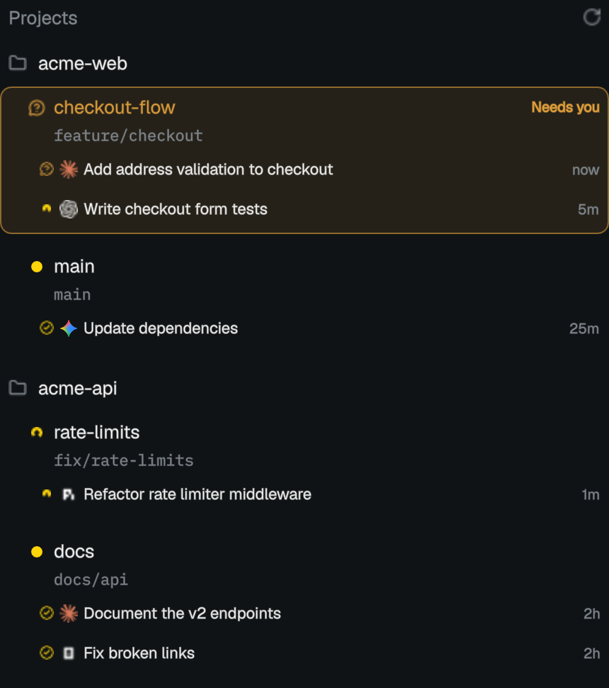

# Orca Monitor

[Orca](https://github.com/stablyai/orca) agent sessions in the [Omarchy](https://omarchy.org) bar, with one click to jump to any of them.



## Install

```sh
omarchy plugin add https://github.com/voyagen/oma-orca-monitor.git --enable
omarchy restart shell
```

Nothing to configure. Orca Monitor reads your local Orca through its CLI, so there is no daemon, account, cloud service or third-party Python package.

Requires Omarchy's Quickshell shell, Hyprland, Python 3, and Orca running with its CLI registered (Settings → Experimental → CLI). Developed against Orca 1.4.x.

Installing from a local checkout instead: `bash install.sh` (validates, tests, enables the widget on the right of the bar). `bash uninstall.sh` removes it.

## Use

The bar shows the Orca logo and a status icon:

| Icon | Meaning |
|---|---|
| Rotating ring | An agent is working |
| Accent dot | Sessions are ready (a turn ended; not proof the work is correct) |
| Question mark | An agent needs your input |
| Interrupted / unknown | Orca reported an interrupted or unrecognised state |
| Muted dot | Orca is unavailable, or nothing is running |

Click the logo to open the panel: projects, workspace cards and always-visible agent rows, newest activity first. Click a card to open its waiting agent, or otherwise its most recently active one, in Orca. The status icon jumps straight to the most recent waiting agent.

| Key | |
|---|---|
| `↑` `↓` / `j` `k` | Select a workspace |
| `Enter` / `Space` | Open it |
| `r` / middle-click | Refresh |
| `Esc` | Close |

Colours follow the active Omarchy theme live; provider logos keep their brand colours.

## Settings

| Setting | Default | |
|---|---|---|
| `refreshIntervalSec` | `3` | Seconds between Orca reads (2–60). Failed reads back off to 10 s or more. |

Change it from the widget settings, or `omarchy bar set voyagen.oma-orca-monitor refreshIntervalSec 5`.

Disable with `omarchy plugin disable voyagen.oma-orca-monitor`; this also stops polling.

## Privacy

Orca Monitor runs `orca worktree ps --json` and `orca terminal list --json` locally. Task labels are short previews of Orca's task title, display name or latest prompt, so they can contain project details; keep that in mind when sharing screenshots. Terminal output, tool arguments and assistant messages are not kept, and nothing is written to disk or logged.

## Limitations

- Only sessions exposed by your local Orca runtime's CLI are shown; omitted hosts are reported, never shown as empty.
- Navigation needs a matching live terminal.
- Read-only: no kill, delete, or prompt sending, and no extra notifications.
- Orca CLI registration may need refreshing after an Orca update.
- If Orca stops responding the panel keeps last-known rows marked stale and disables navigation.

## Development

```sh
python3 -B -m unittest -v      # adapter tests
omarchy plugin validate .
bash test-ui.sh                # isolated QML tests, never touches your Orca
timeout 15 quickshell -p RuntimeTest.qml   # needs Orca running; prints RUNTIME_PASS
```

See [docs/design.md](docs/design.md) for the visual contract and [CHANGELOG.md](CHANGELOG.md).

## Credits

Layout follows Orca's sidebar and [Herdr for Omarchy](https://github.com/jankeesvw/omarchy-herdr); no Herdr code is included. Provider logos come from Orca's source, interface icons are Lucide, the font is Geist. See [docs/asset-sources.md](docs/asset-sources.md) and `licenses/`. Orca and provider trademarks belong to their owners.

MIT licensed.
